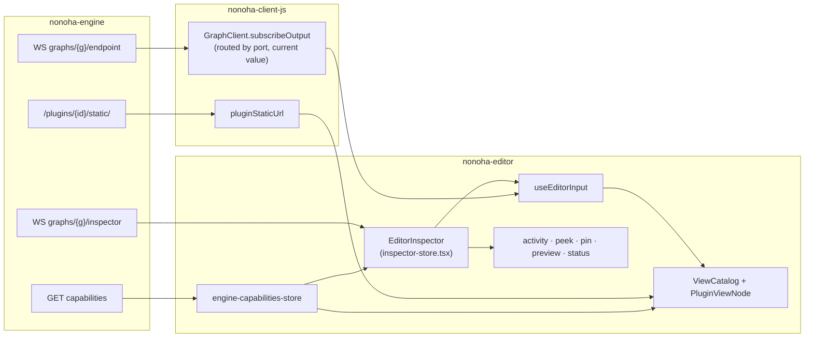

# Monitoring and Views

How the editor shows what flows through a graph, and how plugins add their
own displays. Features switch on the engine's capabilities
(`GET /node-flow/capabilities`), never on its version; engine 1.0 keeps
working without them. The capabilities are read once per engine by
`src/stores/engine-capabilities-store.tsx` (provider in `app/app-layout.tsx`);
the inspector, the view catalog, About and the environment settings read
them there.

## Inspector in the editor

`src/inspector/inspector-store.tsx` holds one `InspectorClient` per open
graph (provider in `app/graphs/page.tsx`).

| Feature | Where | Notes |
|---|---|---|
| Port activity | `activity-output-handle.tsx`, `basic-port-node.tsx` | Ports register while mounted; each re-renders only on its own entry (`useSyncExternalStore`), never via `setNodes`. Rate badge at ≥100% zoom in a fixed-width slot |
| Tooltip | same | Type, Hz, min/max/mean, last value |
| Peek | `peek-popover.tsx`, `inspected-value-view.tsx` | Click a port name. Presentation from `interpretValue` (shape only); bytes show as the image they encode, as a plot only when they do not decode; RGB/BGR remembered per port |
| Pin | `PeekPopover` → page `handlePinRequest` | Display node next to the node (or above the `$graph` frame) + dashed edge; from a graph output port, a solid edge from the port. A graph input has nothing to pin to |
| In-node preview | `node-preview.tsx` | Eye icon in the node toolbar; saved as `nodes.<name>.preview`; samples only on screen, at most 8 |
| Status | `inspector-status-button.tsx` | On / slowed / paused (reason) / off; resume; default on/off (localStorage) |
| About / compat | `components/about-dialog.tsx`, `engine-about.tsx`, `lib/engine-compat.ts` | Supported engines `>=1.0.0 <2.0.0`; outside: chip + one snackbar, never blocks |

## Inputs of display nodes: `useEditorInput`

Every display node reads its handles through
`useEditorInput(graphEndpoint, handleId, onValues, watchOptions, { current })`:

- solid edge from `$output:<port>` → every value (`GraphClient.subscribeOutput`
  of nonoha-client-js). Outputs are sent only when they change, so a state
  (labels, readouts, the rec gate) passes `current`: `true` to get the value
  the port holds now through `onValues`, or a function to take it apart
  (the clear gate primes without firing). A newer value always wins.
- dashed edge from an engine node output → inspector samples
  (`IMAGE_WATCH`, `SNAPSHOT_WATCH`, `LATEST_WATCH`, `CONTROL_WATCH`, or the
  default `batch: "since"` for accumulating charts)

An input takes one connection; a new one replaces it (the replaced edge's
waypoints go with it). A selected dashed edge
offers "Make output port": it creates `$output:<port>`, connects the engine
node to it and feeds the display from the port (solid).

## Editor nodes: single source

`public/editor-nodes.json` is the single source for the editor's own nodes
(handles, settings with defaults, sizes, settings.json conventions). It is
served as `/editor-nodes.json`, ships in `editor_html/`, and the CLI copies
it next to `nonoha ws catalog` output. `src/editor-nodes/specs.ts` derives
the add-menu catalog and prototypes from it; `specs.test.ts` checks it
against the components' real handle ids.

## Views

A view is a read-only display a plugin ships in `static/views/` (or a
built-in one). The contract, the host and the catalog live in
`packages/nonoha-views` (its README is the reference); the editor only
hosts views.

- Catalog: `src/views/view-catalog.tsx` wraps `loadViewCatalog`: the
  built-in views, then each plugin's `static/views/manifest.json` from the
  plugin list (`fetchPlugins` and `pluginStaticUrl` of nonoha-client-js,
  when the engine serves plugin static files). Keys:
  `<plugin id>/<view id>` or `builtin/<view id>`. Built-ins are listed
  before the plugins load.
- Node: `PluginViewNode` loads the module (`loadView`), mounts it with
  `createViewHost`, makes one input handle per view input and feeds it
  through `useEditorInput` as the input declares (`delivery`): dashed
  edges use `watchOptionsFor(input)`, the same options as apps, and
  `"latest"` inputs on solid edges get the current value first (inputs
  subscribe once the view is mounted, so it is not lost). Settings
  are edited as text and resolved by the host (`min`/`max`, `enum`,
  defaults). A missing view keeps its settings and shows a placeholder.
- Add menu → "Views": a view input shows "one of" its accepted types.
  Dropping an edge from an engine output on the canvas offers "Show in …"
  for views that accept its type, views whose `suits` name that output
  first.
- `public/editor-nodes.json` lists the built-in views (`builtinViews`) for
  tools and AI agents; `specs.test.ts` fails when it differs from the
  definitions.
- Views never write to a graph. Inputs to a graph are editor input nodes.
