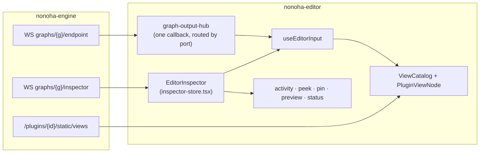

# Monitoring and Views

How the editor shows what flows through a graph, and how plugins add their
own displays. Features switch on the engine's capabilities
(`GET /node-flow/capabilities`), never on its version; engine 1.0 keeps
working without them.

## Inspector in the editor

`src/inspector/inspector-store.tsx` holds one `InspectorClient` per open
graph (provider in `app/graphs/page.tsx`).

| Feature | Where | Notes |
|---|---|---|
| Port activity | `activity-output-handle.tsx`, `basic-port-node.tsx` | Ports register while mounted; each re-renders only on its own entry (`useSyncExternalStore`), never via `setNodes`. Rate badge at ≥100% zoom in a fixed-width slot |
| Tooltip | same | Type, Hz, min/max/mean, last value |
| Peek | `peek-popover.tsx`, `inspected-value-view.tsx` | Click a port name. Presentation from `interpretValue` (shape only); RGB/BGR remembered per port |
| Pin | `PeekPopover` → page `handlePinRequest` | Display node next to the node (or above the `$graph` frame) + dashed edge |
| In-node preview | `node-preview.tsx` | Eye icon in the node toolbar; saved as `nodes.<name>.preview`; samples only on screen, at most 8 |
| Status | `inspector-status-button.tsx` | On / slowed / paused (reason) / off; resume; default on/off (localStorage) |
| About / compat | `components/about-dialog.tsx`, `engine-about.tsx`, `lib/engine-compat.ts` | Supported engines `>=1.0.0 <2.0.0`; outside: chip + one snackbar, never blocks |

## Inputs of display nodes: `useEditorInput`

Every display node reads its handles through
`useEditorInput(graphEndpoint, handleId, onValues, watchOptions)`:

- solid edge from `$output:<port>` → every value (graph output hub)
- dashed edge from an engine node output → inspector samples
  (`IMAGE_WATCH`, `SNAPSHOT_WATCH`, `LATEST_WATCH`, `CONTROL_WATCH`, or the
  default `batch: "since"` for accumulating charts)

An input takes one connection; a new one replaces it. A selected dashed edge
offers "Make output port": it creates `$output:<port>`, connects the engine
node to it and feeds the display from the port (solid).

## Editor nodes: single source

`public/editor-nodes.json` is the single source for the editor's own nodes
(handles, settings with defaults, sizes, settings.json conventions). It is
served as `/editor-nodes.json`, ships in `editor_html/`, and the CLI copies
it next to `nonoha ws catalog` output. `src/editor-nodes/specs.ts` derives
the add-menu catalog and prototypes from it; `specs.test.ts` checks it
against the components' real handle ids.

## Views

- Contract: `packages/nonoha-client-js/src/view-sdk.ts` (`sdk: 1`).
- Catalog: `src/views/view-catalog.tsx` loads `GET /node-flow/plugins`,
  each plugin's `static/views/manifest.json`, and the client's
  `builtinViews`. Keys: `<plugin id>/<view id>` or `builtin/<view id>`.
- Node: `PluginViewNode` loads the module (`loadView`), mounts it with
  `createViewHost`, makes one input handle per view input, and shows the
  view's origin. A missing view keeps its settings and shows a placeholder.
- Add menu → "Views"; dropping an edge from an engine output on the canvas
  offers "Show in …" for views that accept its type (dashed edge).
- `portHints` in manifests set defaults such as `colorOrder: "bgr"` for a
  plugin's image outputs.
