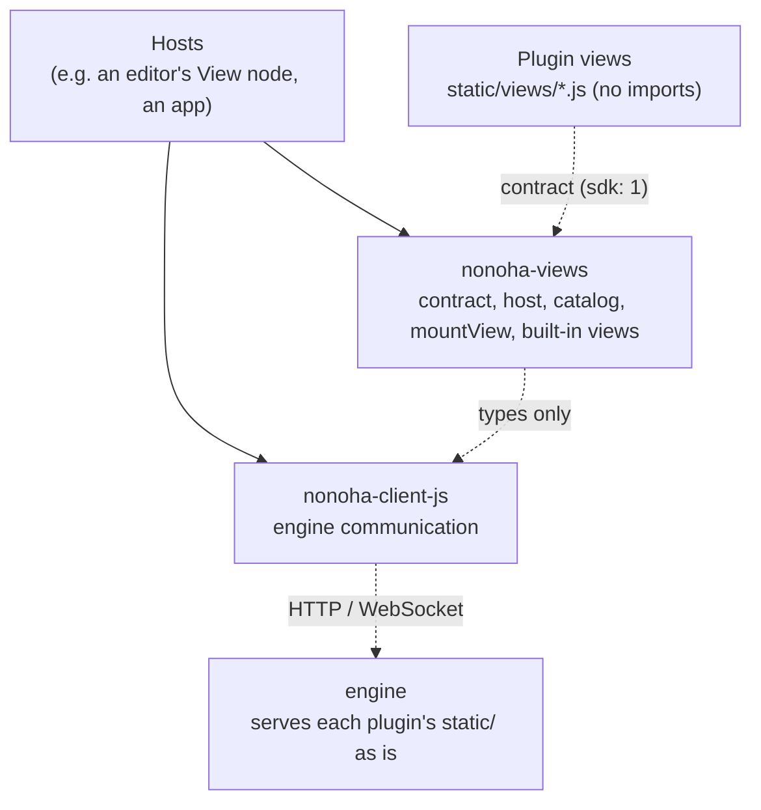

# nonoha-views

Views for nonoha graphs: the contract between view modules and the hosts
that show them, the host, the view catalog, `mountView` for apps, and the
built-in views. This README is the reference for the contract (view SDK 1).

A **view** is a read-only display. Its host hands it the values of graph
ports, and the view draws them into the element it is given. A view never
writes to a graph: graph inputs belong to the host (e.g. input nodes of an
editor, or an app's own controls). Interactions that stay inside the
display, such as zoom or pause, are fine.



nonoha-views uses only the types of nonoha-client-js. Hosts open the
connections and pass the clients in.

## Writing a view

A plugin ships views as plain ES modules with no imports, in
`<plugin>/static/views/`. The default export is the view:

```js
// <plugin>/static/views/level.js
export default {
  sdk: 1,
  id: "level",
  title: "Level",
  description: "Bar of the latest value",
  inputs: [{ name: "values", accepts: ["f32", "f32[?]"] }],
  settings: { max: { type: "number", default: 1, min: 0.001, max: 1000 } },
  size: { width: 200, height: 120 },
  suits: [{ node: "MyMeter", port: "out" }],
  mount(el, ctx) {
    const canvas = el.appendChild(document.createElement("canvas"))
    let latest = 0
    ctx.onValues("values", values => {
      const a = values[values.length - 1].array
      latest = a[a.length - 1] // keep numbers, not the arrays
      ctx.requestFrame(draw)
    })
    function draw() {
      const { width, height } = ctx.size
      canvas.width = width
      canvas.height = height
      const g = canvas.getContext("2d")
      g.fillStyle = ctx.theme.accent
      g.fillRect(0, 0, (width * latest) / ctx.settings.max, height)
    }
    return {
      resize: () => ctx.requestFrame(draw),
      settingsChanged: () => ctx.requestFrame(draw),
      themeChanged: () => ctx.requestFrame(draw),
      destroy: () => canvas.remove(),
    }
  },
}
```

TypeScript views built with this package use `defineView({...})`, which
adds `sdk`.

### Definition

| Field | Meaning |
|---|---|
| `sdk` | Contract version, `1`. Hosts refuse other versions |
| `id` | Unique within the plugin, no `/`. Hosts list the view as `<plugin id>/<id>` (`builtin/<id>` for built-in views) |
| `title`, `description` | Shown by hosts (title defaults to `id`) |
| `inputs` | `[{ name, accepts, description?, optional? }]`. Each input takes one value whose type is any of `accepts` |
| `settings` | `{ <key>: { type, default?, enum?, min?, max?, description? } }` |
| `size` | Initial size in px when a host places the view |
| `suits` | `[{ node, port }]`: engine node outputs the view suits, so hosts can suggest it first |
| `mount(el, ctx)` | Builds the view in `el`; may return the hooks below |

`accepts` uses nonoha type notation without the batch dimension, with `?`
for any size: `"f32"` (scalar), `"f32[?]"` (vector), `"u8[?x?x3]"` (RGB
image), `"f32[*]"` (any rank), `"any[?]"` (any dtype), `"any"` (anything).
Ports carry plain arrays: the view decides what they mean.

### Settings

The host resolves settings once per change, never per frame, and the view
reads `ctx.settings` as is:

- `number`: parsed from text, clamped to `min`/`max`; not a finite number → `default`
- `boolean`: `true`/`false` (or `"true"`/`"false"`); otherwise `default`
- `string`: must be in `enum` when one is given; otherwise `default`
- a setting without a value and without a `default` is absent; keys the view does not declare pass through

### Context and hooks

| `ctx` | Meaning |
|---|---|
| `onValues(input, callback)` | Values of one input, batch first. Valid during the callback only: the host may reuse the arrays, so copy what you keep. Returns a function that stops the callback |
| `requestFrame(draw)` | Runs `draw` on the next animation frame; requests within a frame coalesce. Draw here, not in `onValues` |
| `settings`, `theme`, `size` | Current values (`theme`: colors, `series`, `fontFamily`, `isDark`) |

Hooks returned by `mount`: `resize(width, height)`, `settingsChanged(settings)`,
`themeChanged(theme)`, `destroy()`. `destroy` must release everything the
view made (elements, listeners, timers). Errors thrown by the view go to
the host's `onError`; they never stop the host.

## Manifest

Next to the modules, `static/views/manifest.json` lists the views as data,
so hosts and tools can list them without running code:

```json
{ "sdk": 1, "views": [{ "id": "level", "title": "Level", "description": "…", "module": "level.js", "inputs": […], "settings": {…}, "size": {…}, "suits": […] }] }
```

The manifest is generated from the modules. Every `.js` file in the folder
is a view module:

```bash
node <nonoha-editor>/packages/nonoha-views/bin/view-manifest.mjs --write <plugin>/static/views
node <nonoha-editor>/packages/nonoha-views/bin/view-manifest.mjs <plugin>/static/views  # compare only; exit 1 on a difference
```

The tool also reports modules that break the contract. When a host loads a
module whose `inputs` or `settings` differ from its manifest entry, it uses
the module and warns once.

The engine serves the plugin's `static/` folder as is and reports its path
and revision in the plugin list; it does not know about views. Hosts load
modules with `?rev=<revision>`, so a changed view is never served from the
browser cache.

## Showing views in an app

With a bundler:

```ts
import { GraphClient, fetchPlugins } from "nonoha-client-js"
import { builtinViews, loadViewCatalog, mountView } from "nonoha-views"

const gateway = "localhost:8000"
const graph = new GraphClient(gateway, "my_graph")
graph.connect()

const catalog = await loadViewCatalog(gateway, await fetchPlugins(gateway), { builtins: builtinViews })
const view = await mountView(catalog.get("user_nodes/level")!, element, {
  bindings: { values: "level" }, // view input -> graph output port
  outputs: graph,
  settings: { max: 2 },
})
// later: view.unmount(); graph.close()
```

Without a bundler, load both IIFEs (`nonoha-client.iife.js` gives the
global `NonohaClient`, `nonoha-views.iife.js` gives `NonohaViews`) and use
the same calls.

- `bindings` maps each view input to a graph output port name (every value,
  through `outputs`), or to an internal port `{ node, dir: "out", port }` sampled by
  the inspector (through `samples`, an `InspectorClient`; options from
  `watchOptionsFor(input)` unless the binding gives `watch`).
- `mountView` never opens or closes connections; the app owns the clients.
- `mountView` shows the port's current value first, then every new value.

Hosts with their own value routing use `loadView` and `createViewHost`
directly (e.g. an editor node: `host.deliver(input, values)`,
`host.setSettings`, `host.resize`, `host.destroy`).

## Built-in views

`builtinViews`: `spectrogram` (scrolling heatmap of spectra) and
`level-meter` (RMS and peak per channel). Hosts list them as `builtin/<id>`.
Built-in views follow the same contract as plugin views.

## Development

From the nonoha-editor root:

```bash
npm install
npm run build:deps   # tsc -b (builds nonoha-client-js first)
npm test             # vitest, packages included
npm run build:iife   # dist/nonoha-views.iife.js
```

## License

[Apache-2.0](LICENSE). See also [NOTICE](NOTICE).
